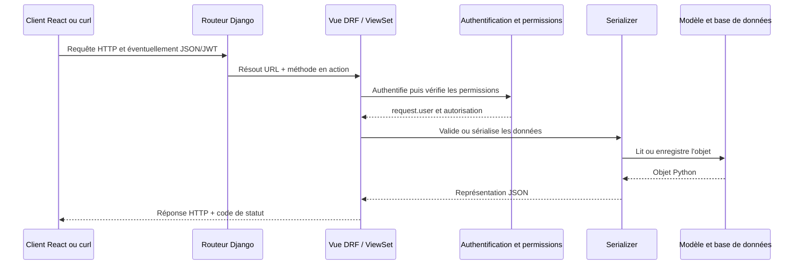
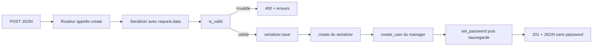
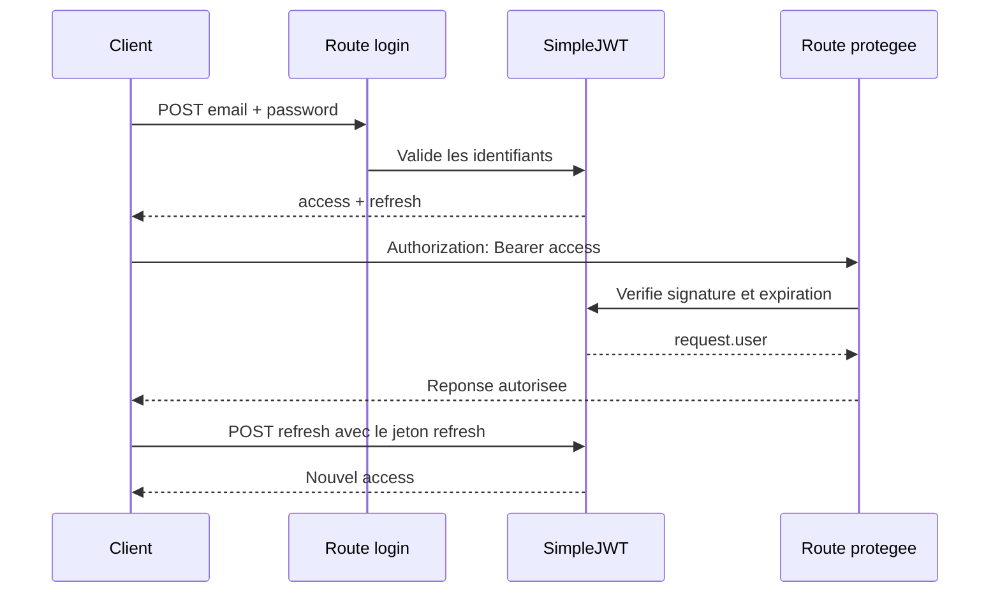

# Guide approfondi de Django REST Framework

Guide pratique en français, adapté à l'API Django de ce projet. Il explique le cycle HTTP, les serializers, les vues, les routes, les permissions, JWT, les requêtes ORM et les syntaxes les plus utiles. DRF étant un framework vaste, ce guide couvre les syntaxes pertinentes ici et les principaux patrons d'usage, pas chaque extension tierce existante.

## 1. Vue d'ensemble

Django REST Framework (DRF) ajoute à Django les outils nécessaires pour construire des API HTTP :

- lire et parser une requête JSON;
- valider les données entrantes;
- appeler la logique métier et l'ORM Django;
- transformer les objets Python en JSON;
- contrôler les permissions et l'authentification;
- associer les méthodes HTTP à des actions CRUD.

DRF ne dessine pas l'interface React. Le serializer prépare les données JSON; React décide comment les afficher.

### Cycle général d'une requête



Le parcours varie selon l'action. Un `GET` ne valide pas de corps JSON; un `POST` valide les données avant l'enregistrement.

## 2. REST et méthodes HTTP

Une API expose des ressources à des URL. Ici, la ressource utilisateur est exposée sous `/api/utilisateurs/`.

| Méthode | Action usuelle | Exemple | Réponse habituelle |
|---|---|---|---|
| `GET` | Lire une liste | `/api/utilisateurs/` | `200 OK` |
| `GET` | Lire un objet | `/api/utilisateurs/3/` | `200 OK` ou `404 Not Found` |
| `POST` | Créer un objet | `/api/utilisateurs/` | `201 Created` |
| `PUT` | Remplacer un objet | `/api/utilisateurs/3/` | `200 OK` |
| `PATCH` | Modifier certains champs | `/api/utilisateurs/3/` | `200 OK` |
| `DELETE` | Supprimer un objet | `/api/utilisateurs/3/` | `204 No Content` |

Ouvrir une URL dans la barre d'adresse du navigateur envoie normalement un `GET`. Pour créer, modifier ou supprimer, le client doit envoyer `POST`, `PUT`, `PATCH` ou `DELETE` explicitement.

## 3. Sérialisation et validation

### Sérialiser un objet vers une réponse JSON

```python
serializer = UtilisateurSerialize(instance)
serializer.data
```

`serializer.data` est une représentation adaptée à la réponse HTTP. Ce n'est pas un affichage d'interface.

### Valider les données reçues

```python
serializer = UtilisateurSerialize(data=request.data)
serializer.is_valid(raise_exception=True)
validated_data = serializer.validated_data
```

`request.data` contient les données parsées par DRF, généralement envoyées en JSON. `is_valid()` exécute la validation des champs et les méthodes de validation. Si les données sont invalides, `raise_exception=True` déclenche une réponse d'erreur DRF, généralement `400 Bad Request`.

Sans `raise_exception=True`, vérifier le résultat avant d'utiliser les données :

```python
if serializer.is_valid():
    serializer.save()
else:
    return Response(serializer.errors, status=400)
```

Ne jamais enregistrer directement `request.data` sans validation.

### `Serializer` et `ModelSerializer`

- `serializers.Serializer` : chaque champ et chaque comportement sont déclarés explicitement.
- `serializers.ModelSerializer` : DRF déduit une partie des champs et des opérations à partir d'un modèle Django.

Syntaxe courante :

```python
class ExempleSerializer(serializers.ModelSerializer):
    class Meta:
        model = MonModele
        fields = ['id', 'nom', 'date_creation']
        read_only_fields = ['id', 'date_creation']
```

`fields = '__all__'` inclut tous les champs détectés du modèle. Pour une API publique, préférer une liste explicite : les nouveaux champs de modèle ne seront ainsi pas exposés accidentellement.

### Champs en lecture seule et en écriture seule

```python
password = serializers.CharField(write_only=True)
```

Le champ `password` peut être envoyé en entrée, mais DRF ne le renvoie pas dans `serializer.data`.

```python
read_only_fields = ['id_utilisateur', 'date_creation']
```

Un champ en lecture seule peut être inclus dans la réponse, mais le client ne peut pas le modifier via ce serializer.

`write_only=True` ne hache pas un mot de passe. Le hachage est une opération séparée du gestionnaire utilisateur avec `set_password()`.

### Validations personnalisées

Validation d'un champ :

```python
def validate_email(self, value):
    if value.endswith('@exemple.invalid'):
        raise serializers.ValidationError("Adresse non autorisée.")
    return value
```

Validation portant sur plusieurs champs :

```python
def validate(self, attrs):
    if attrs['date_debut'] > attrs['date_fin']:
        raise serializers.ValidationError({
            'date_fin': 'La date doit être postérieure à la date de début.'
        })
    return attrs
```

Un champ obligatoire, ses formats et certains validateurs sont vérifiés automatiquement selon sa déclaration et le modèle.

### `create()` et `update()` du serializer

`serializer.save()` choisit la méthode en fonction du contexte :

- sans instance existante : appelle `create(validated_data)`;
- avec une instance : appelle `update(instance, validated_data)`.

Création sécurisée d'un utilisateur dans ce projet :

```python
def create(self, validated_data):
    return Utilisateurs.objects.create_user(**validated_data)
```

Le gestionnaire personnalisé appelle `user.set_password(password)` avant `save()`. Un appel à `Utilisateurs.objects.create(**validated_data)` ne ferait pas ce hachage.

Mise à jour sécurisée du mot de passe :

```python
def update(self, instance, validated_data):
    for attr, value in validated_data.items():
        if attr == 'password':
            instance.set_password(value)
        else:
            setattr(instance, attr, value)
    instance.save()
    return instance
```

`set_password()` hache le nouveau mot de passe. Ne pas affecter la valeur directement avec `instance.password = value`.

Les paramètres fréquemment utilisés :

```python
serializer = MonSerializer(instance, data=request.data)                 # PUT
serializer = MonSerializer(instance, data=request.data, partial=True)  # PATCH
```

`partial=True` rend facultatifs les champs qui ne sont pas envoyés pour cette mise à jour.

### `to_representation()`

DRF appelle `to_representation(instance)` pour convertir un objet en dictionnaire de sortie. Le comportement standard du `ModelSerializer` est généralement suffisant :

```python
def to_representation(self, instance):
    representation = super().to_representation(instance)
    return representation
```

Cette surcharge ne change rien à la sortie. La supprimer est préférable si aucun format particulier n'est requis. Pour personnaliser la sortie, modifier et renvoyer le dictionnaire; ne pas appeler une méthode `read_user()` qui n'existe pas.

## 4. Vues DRF et ViewSets

### `APIView`

Une `APIView` associe les méthodes HTTP à des méthodes de classe explicites :

```python
from rest_framework.views import APIView
from rest_framework.response import Response

class ExempleAPIView(APIView):
    def get(self, request):
        return Response({'message': 'lecture'})

    def post(self, request):
        return Response({'recu': request.data}, status=201)
```

### `ViewSet` et `ModelViewSet`

Un `ViewSet` regroupe les actions d'une ressource. `ModelViewSet` fournit les actions CRUD courantes :

- `list` : liste (`GET` collection);
- `retrieve` : détail (`GET` objet);
- `create` : création (`POST` collection);
- `update` : remplacement (`PUT` objet);
- `partial_update` : mise à jour partielle (`PATCH` objet);
- `destroy` : suppression (`DELETE` objet).

Exemple minimal :

```python
class ProduitViewSet(viewsets.ModelViewSet):
    queryset = Produit.objects.all()
    serializer_class = ProduitSerializer
```

### Cycle de création



Dans DRF, le `create()` standard de `CreateModelMixin` appelle `perform_create(serializer)`, dont le comportement par défaut est `serializer.save()`. Surcharger `create()` n'est nécessaire que si la réponse ou le flux HTTP doit être personnalisé. Pour ajouter un champ automatiquement à la création, surcharger souvent `perform_create()` suffit :

```python
def perform_create(self, serializer):
    serializer.save(cree_par=self.request.user)
```

### Mise à jour et suppression

- Pour personnaliser une modification, utiliser `update()` ou `perform_update()`.
- Le routeur appelle `destroy()` pour `DELETE`, pas une méthode nommée `delete()`.
- Le comportement par défaut de `destroy()` supprime l'objet via `perform_destroy(instance)` et répond `204`.
- Une suppression peut être bloquée par une relation `on_delete=PROTECT`; cette erreur métier doit être gérée pour produire une réponse API claire.

### `get_queryset()`

`queryset` fournit la collection de départ. `get_queryset()` permet de calculer une collection selon la requête :

```python
def get_queryset(self):
    return Commande.objects.filter(cree_par=self.request.user)
```

La syntaxe de traversée des relations Django utilise `__` :

```python
LigneCommande.objects.filter(
    fk_id_commande__cree_par=self.request.user
)
```

Dans ce projet, `Utilisateurs` ne possède pas de champ `cree_par`; ne pas écrire `Utilisateurs.objects.filter(cree_par=...)`. Les modèles `Commande`, `Produit`, `Fournisseur`, `Facture` et `Paiement` ont, eux, un champ `cree_par`. Les lignes de commande passent par leur commande liée.

Attention : `Utilisateurs.objects.all()` expose tous les comptes à tout utilisateur qui passe les permissions. Limiter le queryset ne remplace pas une politique de permissions correcte.

### Actions supplémentaires avec `@action`

Une méthode métier n'est pas automatiquement une route. Pour ajouter une action au ViewSet :

```python
from rest_framework.decorators import action

@action(detail=False, methods=['post'], permission_classes=[AllowAny])
def login(self, request):
    ...
```

- `detail=False` : action sur la collection;
- `detail=True` : action liée à un objet et généralement à son identifiant;
- `methods` : verbes HTTP autorisés;
- le routeur ajoute le chemin, par exemple `/api/utilisateurs/login/`.

Pour les actions de connexion JWT, utiliser le serializer fourni par SimpleJWT ou ses vues standard, plutôt que le serializer ModelSerializer de l'utilisateur.

## 5. Routes et routeurs

Configuration racine du projet :

```python
urlpatterns = [
    path('api/', include('config.api_urls')),
]
```

Inclusion des routes de l'application :

```python
urlpatterns = [
    path('', include('utilisateurs.urls')),
]
```

Routeur de ViewSet :

```python
router = DefaultRouter()
router.register('utilisateurs', UtilisateurViewSet, basename='utilisateur')
urlpatterns = router.urls
```

`register()` prend un préfixe de ressource et un ViewSet. Il ne faut pas lui passer `utilisateurs/<int:pk>` : le routeur crée lui-même la route de détail avec une clé primaire.

Avec ces inclusions, les chemins sont :

| URL | Vue / action |
|---|---|
| `POST /api/token/` | Obtenir les jetons SimpleJWT |
| `POST /api/token/refresh/` | Renouveler l'access avec un refresh valide |
| `POST /api/utilisateurs/` | Créer un utilisateur |
| `GET /api/utilisateurs/` | Lister les utilisateurs autorisés par le queryset |
| `GET /api/utilisateurs/{id}/` | Lire un utilisateur |
| `PUT /api/utilisateurs/{id}/` | Remplacer ses champs modifiables |
| `PATCH /api/utilisateurs/{id}/` | Modifier certains champs |
| `DELETE /api/utilisateurs/{id}/` | Supprimer l'utilisateur si la permission et les contraintes le permettent |
| `POST /api/utilisateurs/login/` | Action login personnalisée si conservée dans le ViewSet |

Le projet expose actuellement à la fois `/api/token/` et l'action `/api/utilisateurs/login/`. Choisir idéalement une seule route de connexion pour éviter la duplication.

## 6. Authentification, permissions et JWT

### Authentification et permission sont deux étapes distinctes

- **Authentification** : identifie l'appelant et remplit notamment `request.user`.
- **Permission** : décide si cet appelant a le droit d'effectuer cette action.

`JWTAuthentication` lit `Authorization: Bearer <access_token>`, vérifie le jeton, puis identifie l'utilisateur. `IsAuthenticated` refuse les requêtes sans utilisateur authentifié.

Configuration actuelle essentielle :

```python
REST_FRAMEWORK = {
    'DEFAULT_AUTHENTICATION_CLASSES': [
        'rest_framework_simplejwt.authentication.JWTAuthentication',
    ],
}

SIMPLE_JWT = {
    'USER_ID_FIELD': 'id_utilisateur',
    'ACCESS_TOKEN_LIFETIME': timedelta(minutes=15),
    'REFRESH_TOKEN_LIFETIME': timedelta(days=7),
}
```

Le réglage `USER_ID_FIELD` est requis parce que la clé primaire de ce modèle s'appelle `id_utilisateur` au lieu de `id`.

Permissions usuelles :

```python
permission_classes = [IsAuthenticated]
```

```python
permission_classes = [AllowAny]
```

```python
@action(detail=False, methods=['post'], permission_classes=[AllowAny], authentication_classes=[])
def login(self, request):
    ...
```

`AllowAny` rend la route publique. `authentication_classes=[]` est utile sur une action de connexion publique pour ne pas tenter d'authentifier un ancien jeton invalide envoyé par erreur.

### Flux JWT



Exemple d'obtention d'un jeton (identifiant `email` pour le modèle de ce projet) :

```powershell
$body = @{ email = 'lea@example.com'; password = 'mot-de-passe' } | ConvertTo-Json
curl.exe -X POST 'http://127.0.0.1:8001/api/token/' `
  -H 'Content-Type: application/json' `
  --data-binary $body
```

Réponse standard :

```json
{
  "refresh": "<refresh_token>",
  "access": "<access_token>"
}
```

Appel protégé :

```powershell
curl.exe 'http://127.0.0.1:8001/api/utilisateurs/' `
  -H 'Authorization: Bearer <access_token>'
```

Renouvellement :

```powershell
$body = @{ refresh = '<refresh_token>' } | ConvertTo-Json
curl.exe -X POST 'http://127.0.0.1:8001/api/token/refresh/' `
  -H 'Content-Type: application/json' `
  --data-binary $body
```

SimpleJWT ne renouvelle pas le jeton automatiquement à la place du client. Le client doit détecter l'expiration ou une réponse `401`, appeler la route de refresh, remplacer l'access, puis retenter la requête. Sans cela, l'accès cesse lorsque l'access expire. Après les 7 jours configurés, une nouvelle connexion est nécessaire avec les valeurs par défaut de rotation.

Ne jamais journaliser, publier ou envoyer un jeton dans une URL. En production, utiliser HTTPS et choisir soigneusement le stockage des jetons côté client.

## 7. Création publique et exposition des données

Le `UtilisateurViewSet` du projet déclare `permission_classes = [IsAuthenticated]`. Cela s'applique aussi à l'action `create` sauf surcharge de permission : un visiteur ne peut donc pas s'inscrire par `POST /api/utilisateurs/`.

Si l'inscription doit être publique, choisir une règle explicite, par exemple :

```python
def get_permissions(self):
    if self.action in ['create', 'login']:
        return [AllowAny()]
    return [IsAuthenticated()]
```

Puis protéger séparément les actions de consultation, mise à jour et suppression. Ne pas simplement rendre tout le ViewSet public.

Le serializer du projet utilise `fields = '__all__'`. Or le modèle utilisateur inclut des champs sensibles ou administratifs comme `is_staff`, `is_superuser`, les groupes et permissions. Pour une API publique, préférer des champs explicitement choisis et protéger les opérations privilégiées. Par exemple :

```python
class Meta:
    model = Utilisateurs
    fields = [
        'id_utilisateur', 'email', 'nomUtilisateur',
        'prenomUtilisateur', 'telephone', 'password',
    ]
    read_only_fields = ['id_utilisateur']
```

`AUTH_PASSWORD_VALIDATORS` dans `settings.py` ne s'exécute pas automatiquement à chaque `CharField` d'un serializer DRF. Si la politique de complexité du mot de passe est requise, appeler les validateurs Django dans le serializer, par exemple avec `validate_password()`.

## 8. Réponses et erreurs

Codes fréquemment observés :

| Code | Signification courante |
|---|---|
| `200` | Lecture ou modification réussie; connexion SimpleJWT réussie |
| `201` | Objet créé |
| `204` | Suppression réussie, sans contenu de réponse |
| `400` | JSON mal formé ou données rejetées par le serializer |
| `401` | Authentification absente ou jeton invalide/expiré selon le mécanisme |
| `403` | Identité connue mais permission refusée; selon l'authentification DRF, l'absence d'identifiants peut aussi produire ce statut |
| `404` | Aucun objet ou aucune route correspondant à la requête |
| `500` | Exception serveur non gérée; examiner le terminal Django |

Erreur de validation typique :

```json
{
  "email": ["Un utilisateur avec cette adresse existe déjà."]
}
```

Il faut examiner à la fois le code HTTP, le corps JSON et le journal Django. Un `404` Apache signifie que la requête n'a pas atteint Django; vérifier le port et le serveur en écoute.

## 9. CORS et client React

CORS est une politique du navigateur. Dans `settings.py`, le middleware CORS doit être placé assez haut dans `MIDDLEWARE`, et `CORS_ALLOWED_ORIGINS` doit contenir exactement l'origine du frontend, protocole et port compris :

```python
CORS_ALLOWED_ORIGINS = [
    'http://localhost:5173',
]
```

`http://127.0.0.1:5173` et `http://localhost:5173` sont des origines distinctes. CORS n'authentifie pas l'utilisateur et ne corrige pas un mauvais port ou une URL API inexistante.

Exemple React avec fetch :

```javascript
const response = await fetch('http://127.0.0.1:8001/api/utilisateurs/', {
  headers: {
    Authorization: `Bearer ${accessToken}`,
  },
})

if (!response.ok) {
  throw new Error(`Erreur API : ${response.status}`)
}

const utilisateurs = await response.json()
```

Si le client envoie un JSON en `POST` :

```javascript
const response = await fetch('http://127.0.0.1:8001/api/token/', {
  method: 'POST',
  headers: { 'Content-Type': 'application/json' },
  body: JSON.stringify({ email, password }),
})
```

`curl.exe` n'est pas soumis à CORS; un test curl réussi ne prouve donc pas à lui seul que le navigateur autorisera la requête React.

## 10. Syntaxes DRF à reconnaître

### Imports habituels

```python
from rest_framework import serializers, status, viewsets
from rest_framework.decorators import action
from rest_framework.permissions import AllowAny, IsAuthenticated
from rest_framework.response import Response
from rest_framework.routers import DefaultRouter
```

### Construire une réponse

```python
return Response(serializer.data, status=status.HTTP_200_OK)
```

Éviter `from rest_framework.response import response` : la classe standard est `Response`, avec majuscule.

### Lire un objet dans une méthode du ViewSet

```python
instance = self.get_object()
```

DRF se sert de `get_queryset()` et du paramètre URL pour trouver l'objet; si aucun objet ne correspond, il renvoie `404`.

### Sauvegardes personnalisées

```python
def perform_create(self, serializer):
    serializer.save(cree_par=self.request.user)

def perform_update(self, serializer):
    serializer.save()

def perform_destroy(self, instance):
    instance.delete()
```

`perform_*` permet de personnaliser l'enregistrement sans réécrire la gestion HTTP entière.

### Filtrage ORM

```python
Commande.objects.filter(cree_par=request.user)
Commande.objects.get(pk=identifiant)
Commande.objects.filter(status='en_attente')
```

- `filter()` renvoie un QuerySet, éventuellement vide;
- `get()` renvoie un objet unique ou lève une exception si absent ou multiple;
- utiliser `get_object_or_404()` dans une vue Django simple, ou `self.get_object()` dans un ViewSet DRF.

## 11. Tester l'API

Démarrer le serveur avec l'environnement virtuel du projet :

```powershell
cd backend\config
..\.env\Scripts\python.exe manage.py runserver 127.0.0.1:8001
```

Vérifier la configuration :

```powershell
..\.env\Scripts\python.exe manage.py check
```

Exemple de test de création : envoyer une adresse e-mail nouvelle, puis contrôler le statut `201`, l'absence du mot de passe dans le JSON de réponse et la présence en base d'une valeur hachée. Employer des données de test, pas des identifiants réels.

Pour un test automatisé DRF :

```python
from rest_framework.test import APIClient

client = APIClient()
login = client.post('/api/token/', {
    'email': 'lea@example.com',
    'password': 'mot-de-passe',
}, format='json')

client.credentials(HTTP_AUTHORIZATION=f"Bearer {login.data['access']}")
response = client.get('/api/utilisateurs/')
assert response.status_code == 200
```

Quand `manage.py check` échoue sur un autre URLconf, distinguer cette erreur d'une route particulière en testant sa résolution et l'endpoint concerné. Corriger le premier échec pertinent avant d'élargir le diagnostic.

## 12. Règles de conception recommandées

1. Préférer une liste explicite de champs sérialisés à `fields = '__all__'` pour les données sensibles.
2. Hacher les mots de passe avec `set_password()` ou le gestionnaire `create_user()`, jamais avec `hashlib` maison ni en clair.
3. Laisser DRF exécuter `is_valid()` avant toute écriture.
4. Garder une seule route de connexion canonique (`/api/token/` ou l'action personnalisée), pas deux comportements divergents.
5. N'exposer que les données appartenant à l'utilisateur courant ou autorisées par son rôle.
6. Rendre l'inscription publique uniquement si c'est un besoin, sans rendre publiques les actions d'administration.
7. Utiliser HTTPS en production; ne pas mettre `DEBUG=True`, une clé secrète de développement ou un mot de passe de base de données vide en production.
8. Traiter explicitement les suppressions bloquées par des clés étrangères `PROTECT`.
9. Tester les réponses HTTP, les permissions et les champs réellement renvoyés, pas seulement le fait que le serveur démarre.

## 13. Résumé mental

- **URLConf/routeur** : où la requête va-t-elle ?
- **Authentification** : qui appelle (`request.user`) ?
- **Permission** : a-t-il le droit ?
- **QuerySet** : quels objets peut-il voir ou modifier ?
- **Serializer** : quelles données sont acceptées, validées et renvoyées ?
- **Modèle/manager** : comment les données sont-elles enregistrées, notamment le mot de passe ?
- **Response** : quel JSON et quel statut HTTP renvoyer ?
- **React** : comment consommer puis afficher le JSON ?
